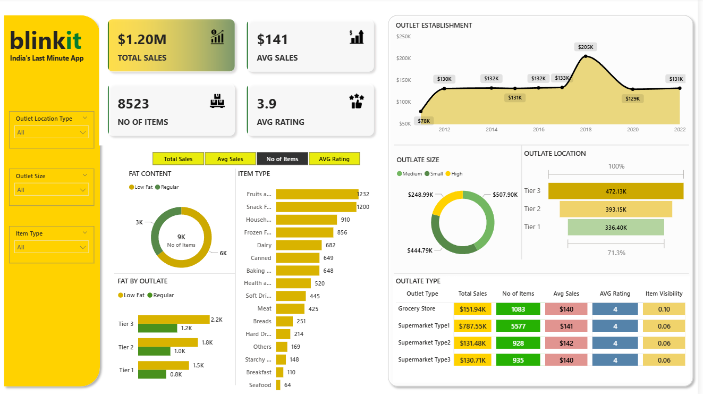

# Blinkit-Sales-Analysis-PowerBI
Blinkit grocery sales analysis dashboard built using Power BI
# Blinkit Sales Analysis

This is a Power BI dashboard I built to analyze sales data from Blinkit, India's quick-commerce grocery app. I wanted to practice turning a raw dataset into something that actually answers business questions: which outlets sell the most, which products move fastest, and how outlet size and location affect sales.

## Dashboard Preview

## What's in this repo

- `Blinkit_Sales_Analysis.pbix` is the Power BI project file
- `BlinkIT Grocery Data` is the dataset I used (Excel/CSV)
- `dashboard.png` is a screenshot of the final dashboard

## About the data

The dataset has one row per item sold at a Blinkit outlet. The main columns I worked with are:

- Item Type and Item Fat Content
- Item Visibility
- Outlet Type, Outlet Size and Outlet Location Type
- Outlet Establishment Year
- Sales and Rating

## KPIs I tracked

- **Total Sales:** overall revenue across all outlets
- **Average Sales:** average sales per item
- **No. of Items:** total number of items sold
- **Average Rating:** overall customer rating

I built these as DAX measures so they update automatically when you use the filters.

## Visuals on the dashboard

- Donut chart showing items split by fat content (Low Fat vs Regular)
- Donut chart showing total sales by outlet size
- Bar chart of items by item type
- Clustered bar chart of items by outlet location type, split by fat content
- Line chart of total sales by outlet establishment year
- Funnel chart of sales by outlet location type
- Matrix table comparing outlet types on total sales, items, average sales, rating and item visibility
- Slicers for Outlet Location Type, Outlet Size and Item Type, so you can filter the whole report

## What I found

- Total sales came to about **1.2M** (1,201,681), with an average of **141** per item across **8,523** items.
- **Fruits and Vegetables** was the top-selling item type (about 178K in sales), with **Snack Foods** close behind (about 175K).
- **Medium-sized** outlets brought in the most sales (about 508K), followed by Small (about 445K) and High (about 249K).
- **Tier 3** locations performed best (about 472K), ahead of Tier 2 and Tier 1.
- The average customer rating was **3.9** out of 5.
- **Low Fat** items made up about **65%** of all items sold (5,517 of 8,523).
- **Supermarket Type1** outlets drove most of the revenue, at about 788K (roughly 65% of total sales).
- Outlets established in **2018** had the highest sales of any year (about 205K).

## Tools used

- Power BI Desktop
- DAX for the measures
- Power Query for cleaning the data
- Excel for the raw dataset

## How to open the project

1. Download `Blinkit_Sales_Analysis.pbix` from this repo.
2. Open it in Power BI Desktop (it's free from Microsoft).
3. Use the slicers on the left to explore the data.

## What I learned

This project helped me get more comfortable with building DAX measures, picking the right chart for the question, and laying out a dashboard so it's easy to read at a glance. If I extend it, I'd like to add a second page for time-based trends and a sales forecast.

## Contact

Feel free to reach out if you have feedback or suggestions.

- LinkedIn: *https://www.linkedin.com/in/pramitde28/*
- Email: *depramit28@gmail.com*
